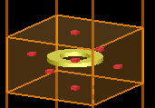
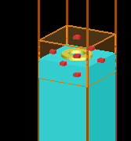
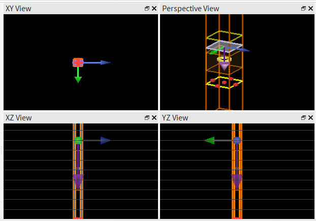

# Perguntas e respostas

Este arquivo registra as perguntas feitas durante a montagem da simulac&#227;o e as respostas correspondentes.

## 1. Pontos vermelhos

> o que s&#227;o esses pontos vermelhos?

S&#227;o os marcadores da regi&#227;o de malha local `mesh_near_Au`. Ela imp&#245;e uma malha de 4 nm nas proximidades do nanoring para resolver as bordas met&#225;licas e os campos pr&#243;ximos. N&#227;o representam uma fonte, uma part&#237;cula nem uma parte f&#237;sica da estrutura.

## 2. Regi&#227;o azul

> mais uma: o que &#233; essa parte azul?

A regi&#227;o azul &#233; o substrato de SiO2 (`SiO2_halfspace`) do caso B. Ela ocupa o volume abaixo de `z = 0`, enquanto o nanoring de ouro fica apoiado na sua superf&#237;cie. O bloco se estende at&#233; o limite inferior da regi&#227;o FDTD para aproximar um substrato semi-infinito e evitar uma interface inferior artificial dentro da simulac&#227;o.

## 3. Absor&#231;&#227;o negativa

> pq deu absor&#231;&#227;o negativa?

A absor&#231;&#227;o &#233; calculada por `A = 1 - R - T`. Portanto, quando os monitores calculam `R + T > 1`, ela fica negativa. Isso n&#227;o significa que o ouro criou energia: &#233; um erro num&#233;rico. Neste caso, a simula&#231;&#227;o terminou pelo limite de tempo enquanto ainda havia campo residual no dom&#237;nio, e a malha r&#225;pida de 6 nm tamb&#233;m reduz a precis&#227;o. Em incid&#234;ncia normal, esse problema n&#227;o foi causado pela remo&#231;&#227;o do BFAST.

## 4. Energia residual e ringing

> como resolver isso? e o que &#233; isso?

Ap&#243;s o pulso da fonte, os campos podem continuar oscilando no nanoring e no dom&#237;nio: isso &#233; chamado de *ringing*. O auto-shutoff mede a energia residual; se ela n&#227;o caiu o bastante, cortar a simula&#231;&#227;o causa erro no espectro. A primeira corre&#231;&#227;o &#233; aumentar o tempo m&#225;ximo de simula&#231;&#227;o e manter o crit&#233;rio de auto-shutoff. O projeto foi configurado com `simulation_duration = 5000e-15` (5 ps) e `auto_shutoff = 1e-6`. Se a energia residual continuar alta ao fim de 5 ps, o pr&#243;ximo teste &#233; aumentar `pml_layers` de 16 para 24 e comparar os espectros.

## 5. Elementos da vista em perspectiva

> no painel superior direito, explique cada elemento

- A caixa alta laranja &#233; a regi&#227;o `FDTD`: o volume num&#233;rico no qual os campos s&#227;o calculados. Seus limites superior e inferior usam PML para absorver ondas que saem do dom&#237;nio.
- O quadrado fino no topo &#233; a fonte plana `TM_incident`. Ela ocupa uma c&#233;lula peri&#243;dica inteira em `x` e `y` e est&#225; em `z = 300 nm`.
- A seta roxa apontando para baixo indica a dire&#231;&#227;o de propaga&#231;&#227;o da fonte, de `+z` para `-z` (`Backward`).
- As setas azul, verde e o marcador central s&#227;o o manipulador de posi&#231;&#227;o/orienta&#231;&#227;o do Lumerical para o objeto selecionado. Elas n&#227;o s&#227;o campos eletromagn&#233;ticos nem parte da estrutura.
- O anel horizontal amarelo/alaranjado no centro &#233; o nanoring de ouro `Au_nanoring`, com a base em `z = 0`.
- A regi&#227;o retangular pr&#243;xima ao anel representa a malha local `mesh_near_Au`, que refina os c&#225;lculos em volta do metal.
- Os pequenos marcadores rosa/vermelhos junto ao anel s&#227;o indicadores dessa regi&#227;o de malha/sele&#231;&#227;o no layout; n&#227;o s&#227;o objetos f&#237;sicos.

## 6. Absor&#231;&#227;o em incid&#234;ncia normal

> O A sempre vai ser constante em 0?

N&#227;o. A absor&#231;&#227;o `A = 1 - R - T` depende do comprimento de onda, da geometria, do material e do meio ao redor, mesmo para incid&#234;ncia normal (`0&#176;`). Como o ouro &#233; dissipativo, em geral ele pode absorver parte da luz. No espectro r&#225;pido do caso em ar, `A` ficou pr&#243;xima de zero na regi&#227;o confi&#225;vel porque o modo em torno de 845 nm &#233; predominantemente refletivo: `R` fica pr&#243;ximo de 1 e `T` pr&#243;ximo de 0. Isso n&#227;o &#233; uma regra geral, e valores negativos ou maiores que 1 s&#227;o artefatos num&#233;ricos, n&#227;o absor&#231;&#227;o f&#237;sica.
